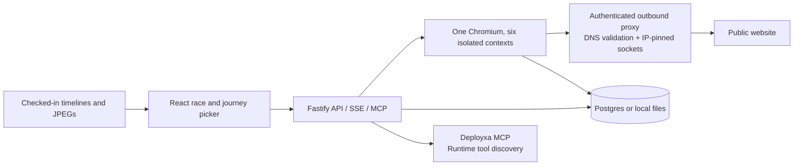

# Finish Line

**Same checkout. Six people. Not everyone finishes.**

Finish Line drives one real activation journey through six isolated Chromium sessions: mouse, keyboard, virtual screen reader, voice-label matching, 320px reflow and a throttled phone. It replays the observed events as a race, with a frame trail, measured counts and deterministic fix prompts.

**Live:** https://finishline-race.vercel.app (UI on Vercel Hobby, proxying to the Render free backend at https://finish-line.onrender.com; the first request after idle can take about a minute). **Local preview:** http://127.0.0.1:3000. **Deployxa hosting:** not used; the account stays connected read-only for local checks. See [docs/HOSTING.md](docs/HOSTING.md).

**Repository:** [rahulgunwanistudy-2005/FinishLine](https://github.com/rahulgunwanistudy-2005/FinishLine). [Completion audit](docs/COMPLETION.md) distinguishes the tested local product from remaining submission inputs.

The original and repaired Corner bakery are **controlled fixtures**, not AI-builder outputs. The recorded engine 0.4.0 runs finish **4/6** and **6/6** respectively. Every result has its actual date and browser evidence. No builder rankings, human sessions or manual assistive-technology results are invented.


This silent GIF captures the actual app playing a recorded controlled fixture. Open the app for spoken announcements and captions. The GIF and narrated demo were recorded before the current Apple-style interface redesign; the engine, recorded runs and results they show are unchanged. Current screenshots are in [docs/screenshots](docs/screenshots).

[Watch the 2:53 narrated demo](docs/finish-line-demo.mp4), with burned-in captions, [separate subtitles](docs/finish-line-demo.srt) and [transcript](docs/DEMO-NARRATION.md). Narration uses the Mac’s offline computer voice. Footage is the actual local app; no human participant or hosted deployment is represented.

## Run locally

Node 24 and pnpm 11 are recommended. After cloning, run:

```sh
pnpm install
pnpm exec playwright install chromium
pnpm dev
```

Open http://127.0.0.1:3000. The checked-in fixture recordings work without Chromium or a database. The engine needs Chromium for new measurements. Public races can activate forms; run only journeys you are authorized to execute.

For the production build: `pnpm build`, then `NODE_ENV=production pnpm start`. Copy `.env.example` to `.env` for optional settings. Never commit keys. The first imported environment module loads `.env` before database or platform clients initialize.

## Architecture



The combined service is intentional. `apps/engine` owns browser drivers and network boundaries; `apps/web/server` owns queue, persistence, SSE, MCP and Deployxa integration; `packages/core` owns strict schemas, reasons and time estimates. A single service avoids an unauthenticated internal job API. `Dockerfile.engine` currently mirrors the combined Dockerfile; it is not a second independently deployed worker.

With DATABASE_URL configured, Drizzle writes races, lane results and JPEG frames into Postgres. Tables initialize at boot; a production database should use managed migrations. Without Postgres, `.data/` provides durable local files. Mount that directory on a persistent volume if deploying this fallback.

## What the lanes measure

| Lane | Real browser behavior | Measured cost | Main failure checks |
| --- | --- | --- | --- |
| Mouse | Click each target and verify its effect | Clicks | Failure invalidates the journey |
| Keyboard | Tab traversal, Enter/Space, Escape from a cycle | Keys | Unreachable, trapped, covered, no activation |
| Screen reader | Tab traversal + CDP accessibility-tree names, roles and states | Announcements | Unusable name or unreachable target |
| Voice control | Visible-label resolution against computed accessible names | Commands | No correct match; duplicates use show-numbers |
| 400% zoom | 320 × 512 CSS pixel viewport, scroll and hit-testing | Screens scrolled | Horizontal access, fixed/sticky occlusion |
| Budget phone | 412 × 823, 150 ms, 1.6 Mbps / 750 kbps, 4× CPU | Wall seconds | Target not usable within its budget |

The spoken lane uses Web Speech after Start race, with captions, mute and rate controls. It does not run an actual screen reader. Voice models command resolution, not speech recognition. See [method](docs/METHOD.md) and [limits](docs/LIMITS.md).

Human time is explicitly estimated. KLM P/K/M constants are sourced; voice, speech and scrolling assumptions are exposed. A finish does not certify WCAG compliance. Engine failures become unknown, never an accessibility DNF. Mouse failure invalidates comparison results.

## Correctness and quality

```sh
pnpm typecheck
pnpm lint
pnpm test
pnpm test:matrix
pnpm build
pnpm check:a11y    # with a local server running
```

Ten HTML fixtures isolate native buttons, clickable divs, empty names, label mismatches, traps, occlusion, reflow, slow rendering, missing key handlers and duplicated labels. All six lanes compare observations against JSON sidecars. The actual generated 60-cell report is [docs/matrix.json](docs/matrix.json), exposed at `/api/matrix` and rendered as a table at `/method`. CI reruns it and includes the report in the run summary.

The official Playwright container also builds and passes **60/60** checks on Linux ARM64. Its real health response confirms Chromium launches: [container report](docs/container-check.json), [Linux matrix](docs/matrix-linux.json). This local verification does not establish Deployxa hosting or container public-network access.

| Fixture | Expected distinction |
| --- | --- |
| good-button | All finish |
| div-button | Keyboard/SR unreachable; voice cannot resolve the clickable div |
| icon-button | Screen reader lacks a name; voice uses numbers |
| label-mismatch | Voice cannot match visible text |
| focus-trap | Keyboard trap; SR cannot reach target |
| cookie-banner | Keyboard/SR target hidden on keyboard focus |
| wide-table | Zoom needs horizontal access |
| slow-button | All finish, with actual phone load cost |
| enter-does-nothing | Keyboard/SR activation fails |
| many-same-labels | Voice disambiguates, counting extra commands |

See [A11Y](docs/A11Y.md) for actual accessibility checks and [manual agreement](docs/AGREEMENT.md) for checks still pending. Browser automation is not a human keyboard or VoiceOver pass.

## API and agent use

- `POST /api/races` — `{url, journey?}`; returns an ID, caching identical inputs for ten minutes.
- `GET /api/races/:id`, `GET /api/races/:id/events` — snapshot and SSE progress.
- `POST /api/journey/scan` — `{url, journey?: priorSteps, authorized?: true}`; screenshot + numbered controls after replaying at most two prior actions. Replay requires authorization; the complete journey is capped at three actions.
- `GET /api/frames/:id`, `GET /api/benchmark`, `GET /api/matrix`.
- `GET /health` — actual Chromium, database and MCP checks, recording provenance, queue state. Unconfigured services are false, not green.
- `GET /health/engine` — a real example.com Chromium screenshot.
- `POST /mcp` — stateless Streamable HTTP, `race_url` and `get_race`, with the same public URL boundaries and rate limits.

Example journey:

```json
{"url":"https://example.com","journey":[{"label":"Learn more","target":{"css":"a"},"expect":{"urlIncludes":"iana.org"}}]}
```

Explicit `urlIncludes` or `selectorAppears` expectations are stronger than mutation-based activation heuristics. The picker can preview selected actions in a fresh isolated browser to reveal later controls, including Checkout inside a cart drawer. Edit previous step and Reset journey replay the shorter prefix. Final races still start at the original URL in six fresh contexts. `pnpm check:picker` verifies selection, preview, edit, reset and submission at 1440px, 390px and 320px using the controlled fixture; see [the actual report](docs/picker-check.json).

## Deployxa integration

Source checked: [Deployxa MCP documentation](https://deployxa.com/docs/mcp-server). Actual CLI checked: **v1.0.8**. The discovery document in the brief returned 404. The app uses the documented `https://mcp.deployxa.com/mcp` endpoint and authenticated `tools/list`, including pagination. [Phase 0 evidence](docs/PHASE0.md).

Configure `DEPLOYXA_API_KEY` server-side with read-only scope. Authenticated discovery returned **66 tools** on 19 October; actual schemas are in `docs/deployxa-tools.json`. The account exposes `deployxa_get_deployment` and `deployxa_get_readiness`, rather than the brief’s status/score names. The client resolves those compatibility names only when an actual tool is discovered and maps its input schema. A fixed allowlist permits audited metadata reads only: remote read-only hints cannot authorize AI requests or any writes. [Zero-spend safeguards](docs/ZERO-SPEND.md).

Metadata discovery retries at most three times after a transient startup failure. Recorded races remain available while it connects, and the deploy page refreshes its state until the bounded attempts finish.

`pnpm check:deployxa` performs only read operations and saves a sanitized account report to `docs/deployxa-check.json`. The verified account is Free, has no projects, reports $0 usage and has auto-top-up disabled. However, it reports a **$50 usage ceiling**, not an enforced $0 cap. No cloud resources were created because the user requires zero spend. The repository provider is not connected. Managed databases and preview deployments are excluded from the free plan. Verify a hard zero-spend limit and free deployment terms before provisioning; do not upgrade, add paid resources or enable top-up. [Current pricing](https://deployxa.com/pricing).

Deploy history lists reported deployments and race links. Race this deploy waits up to 120 seconds for a healthy URL, uses the previous saved journey or an explicitly supplied one, then queues a race. The gate compares against the previous completed race for the same project; only Finish → DNF is a regression. Unknown requires review. Log streaming and automatic attachment of runtime log excerpts have not been implemented.

Rollback is disabled by the zero-spend policy. The endpoint always returns 403 before connecting to a sandbox, even if administrator credentials are supplied. The older bounded sandbox checks remain in source behind that restriction; there is no runtime switch to authorize writes. `pnpm check:zero-spend` verifies the actual server response and policy flags.

A CI integration can run after a real Deployxa deploy. Set FINISH_LINE_ORIGIN, FINISH_LINE_JOURNEY (JSON) and DEPLOYXA_PROJECT_ID as environment variables:

```yaml
- name: Race the deployment
  env:
    FINISH_LINE_ORIGIN: ${{ vars.FINISH_LINE_ORIGIN }}
    FINISH_LINE_JOURNEY: ${{ vars.FINISH_LINE_JOURNEY }}
    DEPLOYXA_PROJECT_ID: ${{ vars.DEPLOYXA_PROJECT_ID }}
  run: node scripts/race-on-deploy.mjs < verified-existing-deployment.json
```

The JSON must describe an existing deployment; this example does not deploy or provision anything. Do not claim hosting or promotion enforcement until the hook has been exercised with a real deployment. The script exits nonzero on regression or incomplete measurement; the UI banner alone is advisory.

## Benchmark recording

`pnpm record` records original and repaired controlled fixtures through the live local API and copies timelines and frames into `benchmark/`. `node --import tsx scripts/record-self.ts` records the permanent homepage self-race. Restart the server to load new recordings. `pnpm record path/to/subjects.json` accepts real builder subjects with title, URL and explicit journey. Preserve each original export and complete transcript according to [the exact prompt](benchmark/PROMPT.md).

## Security and operation

Five races per IP per ten minutes, two active races, at most twenty queued, 45 seconds per lane and up to forty viewport JPEGs per lane. The authenticated outbound proxy resolves and validates DNS and connects to the exact checked IP. All redirect/subresource requests are rechecked. Private/reserved/metadata addresses, alternate protocols, credentialed URLs and unusual public ports are blocked; service workers, WebSockets, downloads and popups are disabled. Local fixture/self-race exemptions are internal, exact and not accepted as user API parameters. Keep production network-level egress isolation as defense in depth.

Health is truthful when dependencies are absent. Recorded races stay available with the engine down. No secret goes to browser code; no API keys are printed in logs.
