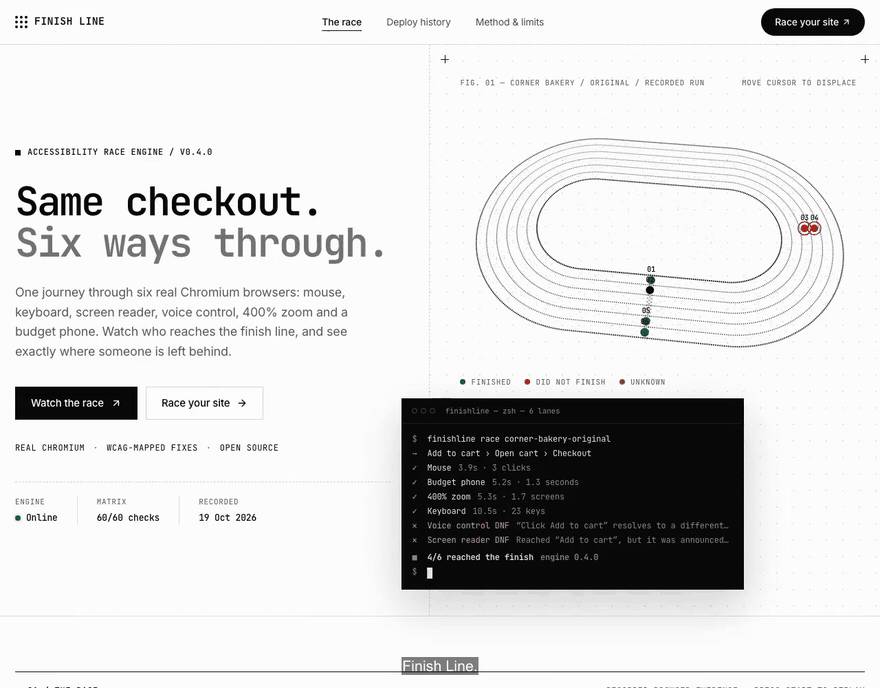

# Finish Line — submission draft

**Tagline:** Same checkout. Six people. Not everyone finishes.

**State:** Working local implementation with a verified Linux container and a 30-second demo GIF. Deployxa URL, original AI-builder exports, manual agreement checks and final narrated video remain pending. Do not submit this draft as though those checks have happened.

The GIF is silent. The app provides actual spoken announcements and captions after Start race.

## The problem

A checkout can work with a mouse and still stop someone using another input method. A successful deployment does not prove a successful journey.

Four sources checked on 19 October 2026:

1. [WebAIM Million 2026](https://webaim.org/projects/million/) reports empty buttons on 30.6% of home pages, empty links on 46.3% and missing form labels on 51%. Detected errors per page rose 10.1%. WebAIM discusses AI-assisted coding among possible broader contributors; this is not a causal experiment.
2. The [Netherlands Authority for Consumers and Markets](https://www.acm.nl/en/publications/acm-majority-large-online-stores-are-not-accessible-customers-disabilities) found assistive-technology ordering impossible on 61% of approximately 100 major Dutch stores tested.
3. An [AudioEye-sponsored article and study](https://venturebeat.com/ai/we-asked-five-ai-tools-to-build-accessible-websites-all-15-sites-failed) reports all 15 AI-built sites failed WCAG Level A. This is vendor-sponsored evidence, separate from our own results.
4. [WHO’s August 2026 fact sheet](https://www.who.int/europe/news-room/fact-sheets/item/disability) reports over 1.3 billion people living with disability. This updates the older “over 1 billion” wording in the project brief.

## What we built

Finish Line replays one activation journey through six isolated Chromium contexts. Mouse sets the validity check. Keyboard counts keys. A virtual screen-reader lane speaks actual accessibility-tree announcements with captions. Voice control resolves the visible label against computed accessible names. Reflow measures access at 320 CSS pixels. A throttled phone measures time to usable controls.

Measured counts and browser frames are facts about the run. Human time is a labeled estimate with published KLM constants and clearly separated project assumptions. Every DNF opens an event trail, related WCAG criteria and a deterministic fix prompt. Engine failures say unknown.

## Current result

The controlled original bakery records four of six finishes; the repaired fixture records six of six. The original deliberately lacks a usable accessible name on the first Add to cart button. These are hand-authored fixtures, not AI-builder exports. The engineer judges can inspect every frame and rerun the ten-fixture correctness matrix.

The real AI-builder leaderboard is intentionally pending at least three unmodified exports with original transcripts. Add actual results here after recording. Never attribute the controlled bakery to a builder.

## Proof

- Correctness matrix: `/method`, `docs/matrix.json`, rerunnable `pnpm test:matrix`.
- Linux container: build passed, Chromium launches and 60/60 fixture expectations pass; `docs/container-check.json`, `docs/matrix-linux.json`.
- Dated recordings: `benchmark/runs/2026-10-19/`; original browser JPEGs in `benchmark/frames/`.
- Self-race: permanent benchmark entry after its measured run.
- Current quality evidence: `docs/A11Y.md` and `docs/a11y-results.json`.
- Manual agreement: `docs/AGREEMENT.md`; currently no manual agreement rate.
- Truthful health: `/health`. Repository and hosted URL to be added after publication.

## Deployxa

“Deployxa’s readiness score says your app will run. Finish Line asks who can use it.”

The server includes authenticated, paginated MCP tool discovery, deploy history, healthy-deploy racing, an advisory regression gate, administrator-only sandbox rollback and a CI gate script. Finish Line also exposes `race_url` and `get_race` through its own Streamable HTTP MCP server.

The official [Deployxa documentation](https://deployxa.com/docs/mcp-server) confirms its MCP endpoint and agent integration. Hosting and account-specific tools remain unverified without credentials. Managed Postgres and previews depend on the actual plan. Replace this paragraph only with verified deployment evidence after connecting.

## Accessibility and limits

Finish Line has keyboard-operable controls, visible focus, reduced-motion final results, captions and mute, text statuses, a results table and mobile reflow. Actual automated results are in A11Y.md. A human VoiceOver/NVDA pass is still required. A successful journey is not a WCAG certificate; virtual Tab navigation and voice-name matching do not cover every assistive-technology route.

## Built with

TypeScript, React, Vite, Fastify, Playwright/Chromium, CDP accessibility APIs, PostgreSQL/Drizzle (optional until connected), Zod, MCP TypeScript SDK, Web Speech, Vitest and axe-core. Barlow and Barlow Condensed typography. Deployxa integration pending account verification.

## Video script — 2 minutes 50 seconds

**0:00–0:20 — Cold open.** Start the original controlled bakery recording. Keep “Controlled fixture” and recording date visible. Let the actual announcements play. Open the screen-reader DNF: “This control looks like Add to cart, but Chromium exposes only ‘button’.” Show the real finish count.

**0:20–0:35 — Why.** “A live URL proves the app runs. It doesn’t prove everyone can finish. Finish Line measures the same journey through six input methods.” Do not describe this controlled store as an AI-generated subject.

**0:35–1:05 — The tool.** Paste an authorized public URL. Scan, choose a journey, start a live race. Open evidence, show a real frame and copy a fix prompt. If the remote site fails, show unknown honestly and use the controlled recording for the remaining demo.

**1:05–1:25 — The proof.** Show the fixture matrix and explain one deliberately broken behavior. Show manual agreement only if actually recorded. Show the dated benchmark leaderboard only when real exports are available.

**1:25–1:55 — Deployxa.** With a connected account, show discovered tools, deployment history, readiness and a deploy-triggered race. Demonstrate sandbox rollback only in the authenticated sandbox. Until the key is available, show the unconnected state and explain the unfinished integration plainly.

**1:55–2:25 — Repair.** Switch to the repaired controlled fixture (or a real repaired benchmark if available). Replay the measured six finishes. “The visible button barely changed. The journey did.” Show the exact fix and dated rerun.

**2:25–2:50 — Close.** Show the self-race, health, repository and honest limits. “Push code. Everyone finishes.” Add the verified Deployxa live URL when available.

## Remaining human inputs before submission

- Deployxa account key; sandbox key/project if demonstrating rollback; actual plan capability checks.
- At least three builder exports and complete transcripts using benchmark/PROMPT.md.
- Keyboard-only and VoiceOver/NVDA manual passes and per-store agreement rows.
- Final narrated video, final verified live URL and Devpost upload.
